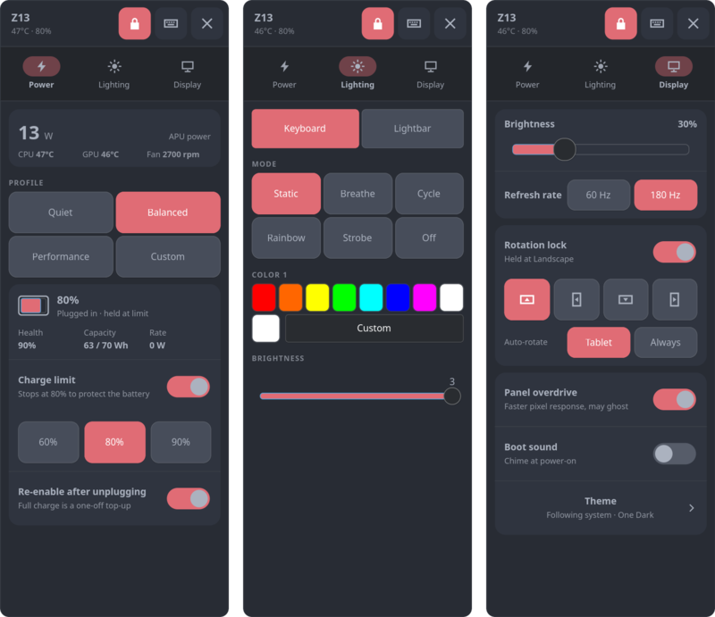
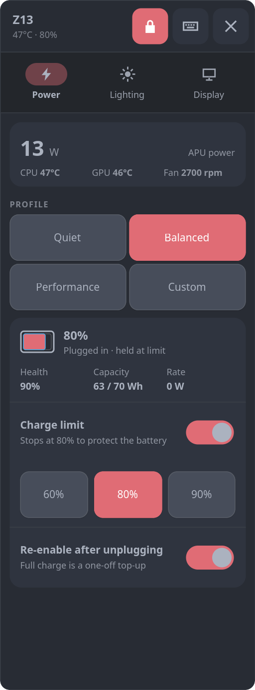
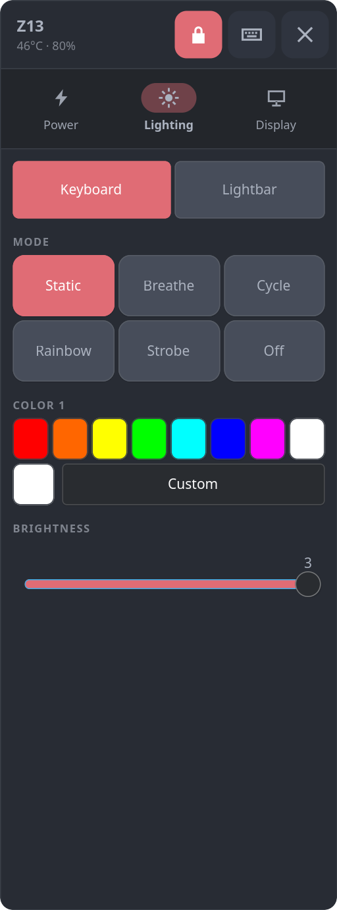
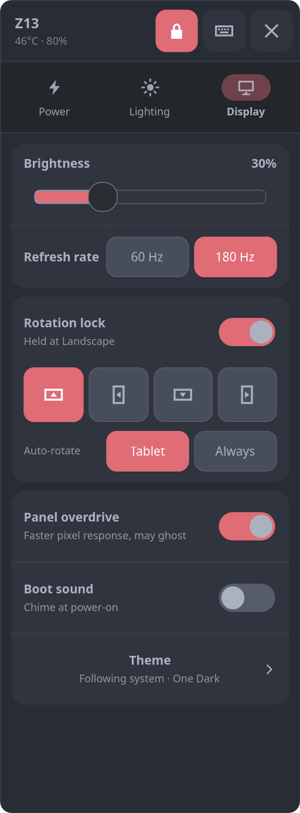

# z13gui

GTK4 overlay drawer for [z13ctl](https://github.com/dahui/z13ctl) on Wayland —
a touch-first redesign of [dahui/z13gui](https://github.com/dahui/z13gui).

[](LICENSE)



`z13gui` is the graphical companion to z13ctl — a slide-out drawer opened by the
Armoury Crate button (KEY_PROG3) on the ASUS ROG Flow Z13. It renders as a Wayland
layer-shell overlay (KDE Plasma, Hyprland, Sway), as a transparent click-through
overlay on compositors without layer-shell (GNOME), or as a gamescope X11 overlay in
Steam Gaming Mode. Hardware control goes through the z13ctl daemon.

This fork reorganises the drawer into three tabs built for using the Z13 as a
tablet: every target is at least 48px, a switch row toggles from anywhere on the
row, and the controls you reach for with the keyboard detached — rotation lock,
on-screen keyboard, brightness — are one tap away.

## What's in the drawer

**Header** — temperature and battery, a quick **rotation-lock** button, the
**on-screen keyboard**, and a close button (no Escape key in tablet mode). A
**Game mode** badge appears while [Feral GameMode](https://github.com/FeralInteractive/gamemode)
has a game running.

| Power | Lighting | Display |
|---|---|---|
|  |  |  |
| Live APU power, CPU/GPU temperature and fan speed. Quiet / Balanced / Performance / Custom profiles (Custom opens TDP, fan curve and undervolt). Battery card with health, capacity and charge rate, a **charge-limit switch** with 60/80/90% presets, and **re-enable after unplugging** so a full charge before leaving is a one-off. | Keyboard and lightbar RGB: mode, colours (presets or an HSL picker), speed and brightness. | Screen **brightness** (snaps to 5%), **refresh rate** (60 / 180 Hz), **rotation lock**, orientation and auto-rotate policy, panel overdrive, boot sound, and theme. |

**Themes** — 16 built-in themes with accent variants (including One Light and One
Dark as a pair), plus custom `theme.toml` / `theme.css`. Themes can **follow the
system light/dark setting**, with a separate pick for each mode; the drawer
re-themes the moment the desktop switches.

**Gamepad** — every control is in a D-pad focus grid; the shoulder buttons switch
tabs.

### Desktop support

Everything that goes through z13ctl or the kernel's sensors works on any desktop.
The Display tab's brightness, refresh-rate and rotation controls and the
on-screen-keyboard button use KDE Plasma (`org.kde.ScreenBrightness`,
`kscreen-doctor`, KWin's virtual keyboard); elsewhere those rows are hidden rather
than left to fail. Following the system theme uses the XDG desktop portal and works
on KDE, GNOME and most others.

Nothing runs in the background while the drawer is closed beyond waiting for the
Armoury Crate button (about 0.1% of one core).

## Build and install

Requires Go, a C toolchain, GTK4 and `gtk4-layer-shell` (`pkg-config gtk4-layer-shell-0`),
and a running [z13ctl](https://github.com/dahui/z13ctl) daemon.

```sh
git clone https://github.com/richardklint/z13gui
cd z13gui
make build            # first build compiles the GTK bindings and takes a few minutes
make test             # unit tests (no GTK needed)
install -Dm755 z13gui ~/.local/bin/z13gui
```

To run it as the `z13gui` user service in place of a packaged build, add a drop-in:

```ini
# ~/.config/systemd/user/z13gui.service.d/override.conf
[Service]
ExecStart=
ExecStart=%h/.local/bin/z13gui
```

```sh
systemctl --user daemon-reload && systemctl --user restart z13gui
```

Delete the drop-in and reload to go back to the packaged version. Without an
existing service, `contrib/z13gui.service` can be installed instead; see the
upstream [installation guide](https://dahui.github.io/z13gui/installation/).

## Quick start

Press the **Armoury Crate button** to open the drawer. Press it again, tap ✕, click
outside, or press Escape to close it. Changes are sent to the z13ctl daemon (or the
desktop) immediately and persist across reboots. Drawer preferences live in
`~/.config/z13gui/prefs.conf`; theme choices in `~/.config/z13gui/config.toml`.

## Documentation

The upstream documentation covers installation, configuration and theming:
**<https://dahui.github.io/z13gui>**. Architecture notes for this fork are in
[CLAUDE.md](CLAUDE.md).

## License

[Apache 2.0](LICENSE). Based on [z13gui](https://github.com/dahui/z13gui) by Jeff
Hagadorn.
